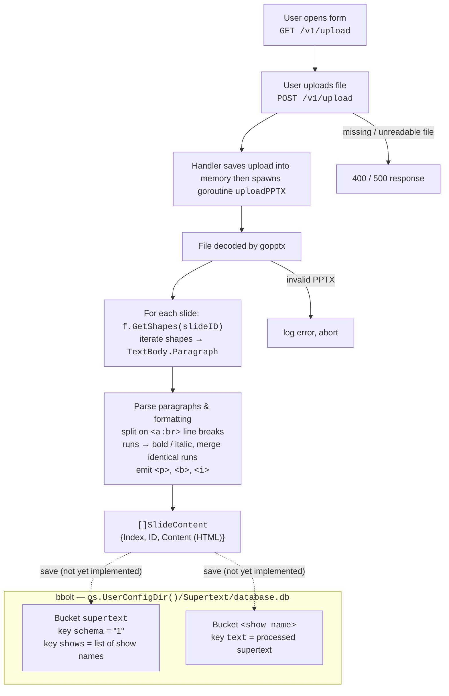
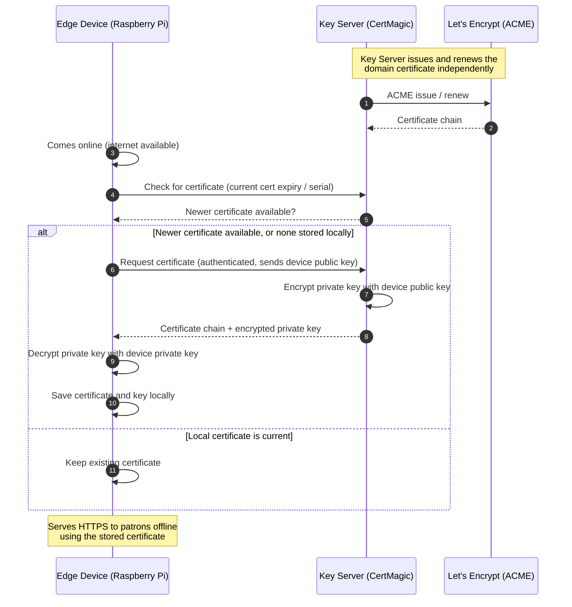
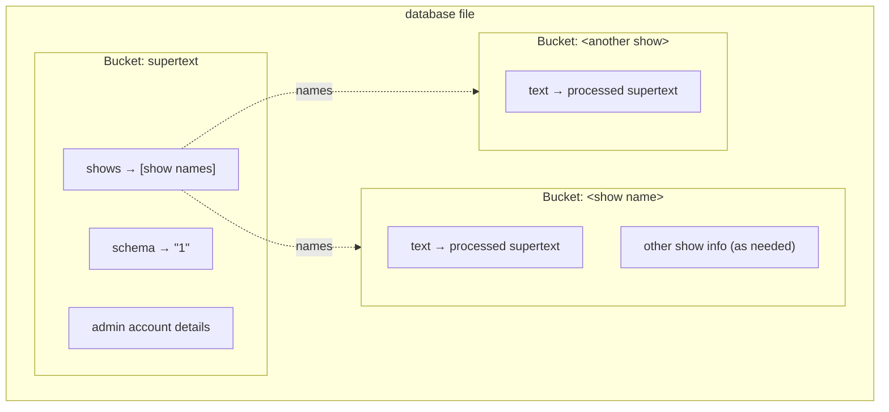

# Supertext Design

## Overview

The portable supertext application for the Portland Opera is built with the
following technology: Go (chosen for its simple syntax and ability to support
high concurrency applications), htmx (chosen for its simple approach to
modifying html content with server sent html), bbolt (chosen due to the fact
that it lives inside the application and due to the simple nature of the
documents stored), and a Raspberry Pi (chosen as simple bringup requirements,
great documentation and ecosystem support and relatively high performance).

All of these were chosen in accordance to the
[requirements.md](docs/requirements.md).

## Deployment and Production Target

The walking skeleton will be run on the prototype Raspberry Pi which will also
serve as a staging environment when testing new builds for the network related code.
When the application goes into production the Pi will be owned by the Portland
Opera as that is the edge device that is responsible for creating the network
onsite. This was agreed upon by both the project partner and team when
evaluating the project requirements as per [requirements.md](docs/requirements.md).

## Interfaces and Contracts

All HTTP endpoints follow the conventions in
[ADR-001](adr/ADR-001-ENDPOINTS.md):

- Paths are lowercase kebab-case and versioned (`/v1/...`). Old versions keep
  working.
- Payloads are JSON or `multipart/form-data`, with camelCase keys.
- Responses wrap their content in `{"data": ...}` on success or
  `{"error": {"code", "message"}}` on failure, where `code` is the HTTP status
  in uppercase.
- A single resource goes in the path (`/v1/edit/<presentation_name>`).

### Endpoints

- **`GET /`**: serves `web/static/index.html`, a landing page with a link to
  the upload page.
- **`GET /web/*`**: serves static files from `web/` (htmx and the HTML pages).
- **`GET /v1/upload`**: serves `web/static/upload.html`, the upload form.
- **`POST /v1/upload`**: takes the uploaded presentation as
  `multipart/form-data`.
  - Fields: `name` (presentation name, text) and `file` (`.pptx`).
  - Success: 200 with an empty body. Decoding happens afterwards in a
    goroutine, so the response doesn't say whether decoding succeeded.
  - Errors: 400 if the file is missing or unreadable, 500 if reading it fails.
    Both return plain text.
- **Slide content format** (`upload.SlideContent`): `{Index int, ID int,
  Content string}`.
  - `Content` is HTML limited to `
`, `<b>` and `<i>`.
  - Line breaks within a paragraph become separate `
` elements, and an empty
    slide becomes `

`.
- **`GET /v1/slides`** ([ADR-003](adr/ADR-003-FRONTEND.md)): returns the
  whole presentation once when a patron connects, as
  `{"slides": [{"slideNum": 1, "data": "
…
"}]}`.
- **`GET /v1/present`** ([ADR-003](adr/ADR-003-FRONTEND.md)): a server-sent
  events stream for slide changes.
  - Each change is sent as `event: show-slide` with `data: <slide number>`.
  - Clients have to reconnect after a drop and return to the current slide.
- **Admin page** ([ADR-005](adr/ADR-005-ADMINISTRATION.md)):
  - Login with a session and password.
  - A view for checking uploaded slides before the show.
  - An API for editing slide text in place.
  - Keyboard controls (arrow keys, spacebar) that send cues.
  - Possibly `.txt` uploads in addition to `.pptx`.
  - None of these have endpoint paths defined yet.
- **Key Server API** ([ADR-004](adr/ADR-004-KEY-SERVER.md),
  [RFC](rfcs/2026-10-25-Key-Server-and-Edge-Device-Encryption.md)):
  - A "check certificate" request, and an authenticated "request certificate"
    request that sends the Pi's public key.
  - The response is the certificate chain plus the private key, encrypted with
    the Pi's public key.
  - Requests without authentication must be rejected.
  - No paths or payloads are defined yet. See
    [Key Server Certificate Provisioning](#key-server-certificate-provisioning).

### Other contracts

- **Server port**: the server listens on `:8081`, hardcoded in `cmd/main.go`.
- **Storage**: see [Data Schema / Storage](#data-schema--storage).

### Known inconsistencies

- **WebSockets or server-sent events.** `AGENTS.md` describes syncing over
  WebSockets, but ADR-003 specifies server-sent events.
- **Endpoint version.** ADR-003 writes `/vx/slides` and `/vx/present`. This
  document treats them as `v1`.
- **Slide field names.** The code produces `Index`, `ID` and `Content`, but
  ADR-003 expects `slideNum` and `data`. ADR-003 also numbers slides from 1,
  while `Index` starts at 0.
- **`POST /v1/upload` and ADR-001.** It returns plain-text errors and an empty
  success body instead of the JSON envelope. It also has no way to report
  decoding failures back to the admin.
- **Database file location.** See
  [Data Schema / Storage](#data-schema--storage).

## Deferred Decisions

- How data encryption keys are generated and shared between the edge device and the keyserver
    - [ADR-004](adr/ADR-004-KEY-SERVER.md) only says the edge device pulls the
      private key from the Key Server. The
      [Key Server RFC](rfcs/2026-10-25-Key-Server-and-Edge-Device-Encryption.md)
      leaves open whether to use one shared key, per-device certificates, or
      short-lived credentials, because a compromised device exposes the key for
      the shared domain.
- Authentication mechanism of edge device to key server
    - [ADR-004](adr/ADR-004-KEY-SERVER.md) and the
      [Key Server RFC](rfcs/2026-10-25-Key-Server-and-Edge-Device-Encryption.md)
      require an "authenticated request". The RFC's acceptance criteria require
      unauthenticated requests to be rejected. Neither says how the device
      authenticates.
- Database migrations strategy
    - How changes in the database schema have not been considered, and how to move from one data format to another
    - [ADR-002](adr/ADR-002-DATABASE.md) and the
      [Database Engine RFC](rfc/2026-10-25-Database-Engine.md) don't cover
      migrations. In the code, `database.Open()` compares the stored `schema`
      version with `DATABASE_SCHEMA_VERSION` and only logs a warning when they
      differ. That's where migrations would run.

## Sensitive Data

Much of this project has been designed to avoid storing any sensitive data.
However, due to the requirement of HTTPS while offline and the nature of private
key encryption, the application must act tactfully when handling the private key
data. To avoid leakage of this data, the edge device uses private key encryption
when receiving the private keys across network.

Administration password management currently follows common ISP practice of
providing the username and password on the device itself. Given that it is
required to hold the device to use the device, following this threat model is
likely fine.

## Upload Processing

How an administrator's PowerPoint (`.pptx`) presentation becomes stored Supertext.

### Notes

- Decoding runs in a background goroutine, so the `POST` returns before parsing
  finishes. The handler copies the upload into memory first so the goroutine
  doesn't depend on the request body.
- The bucket layout shown (`shows` key, one bucket per show holding `text`)
  comes from [ADR-002](adr/ADR-002-DATABASE.md). ADR-002 names the file
  `supertext.db` under `$XDG_DATA_HOME`, but `database.ConstructDatabasePath`
  actually uses `os.UserConfigDir()/Supertext/database.db` and falls back to
  `$XDG_DATA_HOME` only if that lookup fails.

## Key Server Certificate Provisioning

How the edge device (Raspberry Pi) gets a TLS certificate for the shared domain,
per [ADR-004](adr/ADR-004-KEY-SERVER.md) and the
[Key Server RFC](rfcs/2026-10-25-Key-Server-and-Edge-Device-Encryption.md).

### Notes

- Nothing here is implemented. All diagrams are currently based on drafted ADR & RFCs.
- The Pi needs its own keypair before step 6. The current drafts doesn't say yet where
  that comes from (generated on first boot or provisioned at setup), or how the
  Key Server learns which device public keys to trust.
- The Pi has to sync before the certificate expires. The RFC suggests renewing
  with 30 days left and showing a visible warning if a sync fails.

## Data Schema / Storage

Supertext stores application data in [bbolt](https://github.com/etcd-io/bbolt),
an embedded key/value store, per [ADR-002](adr/ADR-002-DATABASE.md). Since the app
mostly preforms basic reads and writes, it doesn't need a relational database.

### Layout

- **`supertext` bucket:** the primary bucket.
  - `schema`: the database schema version (`DATABASE_SCHEMA_VERSION`, currently
    `"1"`).
  - `shows`: an array of show names.
  - Admin user account details.
- **One bucket per show:** each is named after its entry in `shows`.
  - `text`: the processed supertext, i.e. the HTML slide content produced by
    upload processing.
  - Any other show information, if it's needed.

### Implementation status

- `database.Open()` creates the `supertext` bucket and writes `schema` if it's
  missing. If the stored version doesn't match `DATABASE_SCHEMA_VERSION`, it
  only logs a warning for now; this is the place where migrations would run.
- `shows`, the per-show buckets, and admin account storage aren't implemented
  yet.
- **File location:** ADR-002 specifies `supertext.db` under `$XDG_DATA_HOME`.
  The code uses `os.UserConfigDir()/Supertext/database.db` and falls back to
  `$XDG_DATA_HOME/Supertext/database.db`.
- **Concurrency:** bbolt transactions aren't safe to share between goroutines,
  but opening a transaction is. Each goroutine, such as the `uploadPPTX`
  worker, must open its own transaction.
